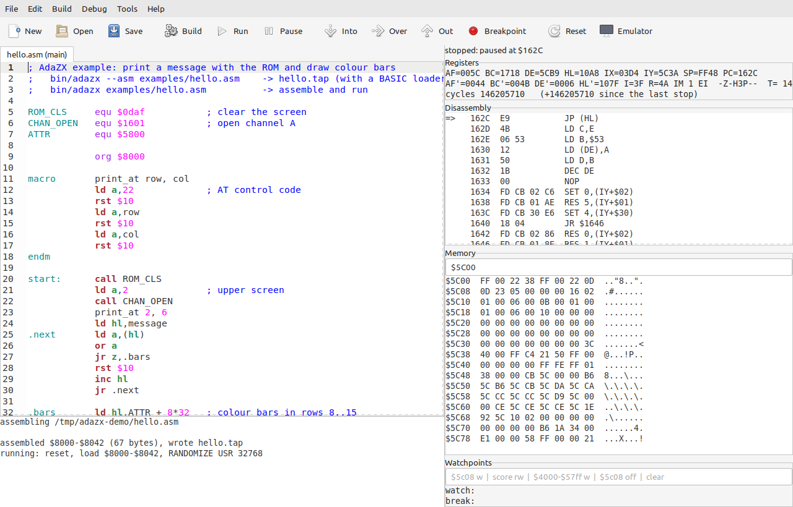
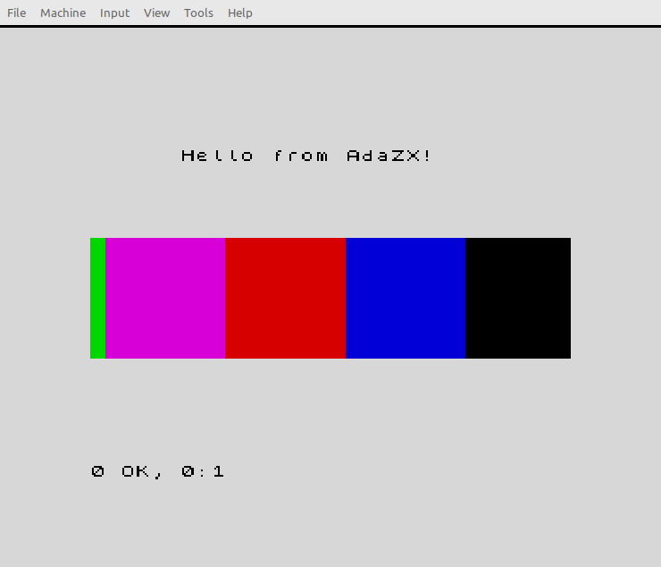
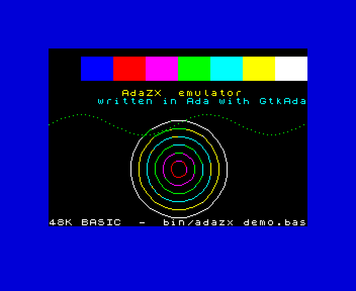
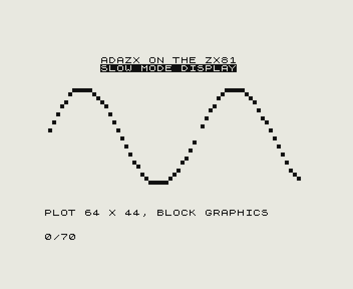
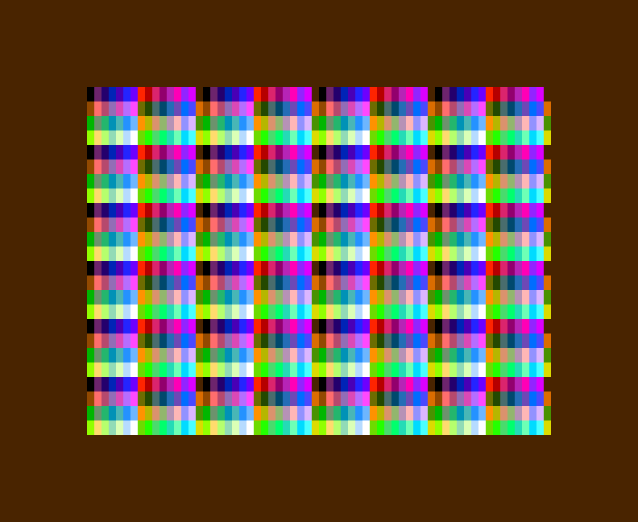

# AdaZX

A ZX Spectrum, Pentagon, Timex, ZX81 and ZX80 emulator written in Ada 2012
with GtkAda, with **Forge**: a Z80 assembler IDE, Sinclair BASIC editor,
source-level debugger, profiler, disassembler and graphics editors around
the running machine. It is the Sinclair sibling of AdaC64 and AdaBeeb.

| | |
|---|---|
|  |  |
| `examples/hello.asm`, built and run from Forge | `examples/demo.bas` on the 48K |
|  |  |
| `examples/demo.b81` on the ZX81 | `examples/ulaplus.asm` with `--ulaplus` |

## Highlights

* **Machines:** ZX Spectrum 16K, 48K, 48K NTSC, 128K, +2, +2A, +3 (with its
  disc drive), Pentagon 128, Timex TC2048 and TC2068, Sinclair ZX81 and
  ZX80.
* **Accurate:** a Z80 core timed per memory and I/O cycle. It passes
  Fuse's per-cycle tests, ZEXALL, every variant of Patrik Rak's z80test,
  and all 72 cases of Richard Butler's 48K timing tests, including the
  floating bus. The ZX81 display is generated the way the real hardware
  does it, hi-res included.
* **Add-ons:** Interface 1 with Microdrives, DivMMC with esxDOS and SD
  cards built from a host folder, Beta 128 (TR-DOS), Multiface 128,
  Kempston mouse and joystick, ZX Printer, ULAplus, ZX81 sound boards.
* **Files:** TAP, TZX (including turbo, generalized data and CSW), Z80,
  SZX, SNA, RZX (play and record), DSK, MDR, TRD, SCL, P / 81, O / 80,
  SCR; BASIC and assembler sources start directly.
* **Forge:** assemble and run with F5, source-level debugging of
  assembler and BASIC, conditional breakpoints, a profiler, memory as
  re-assemblable source, and editors for UDGs, SCREEN$ and ZX81 screens.

## Building

On Ubuntu 22.04:

    sudo apt install gnat gprbuild libgtkada20-dev libgtksourceview-4-0 \
                     libpulse-dev zlib1g-dev
    make                 # bin/adazx and bin/adazx-forge
    make tests           # the test suite (see "Accuracy and tests")
    make zexall          # ZEXALL, every Z80 instruction (about a minute)

The emulator needs ROMs to start; see [ROMs](#roms).

## Running

    bin/adazx                 # the model used last time (48K at first)
    bin/adazx --128           # or --16 --48ntsc --plus2 --plus2a --plus3
                              #    --pentagon --tc2048 --tc2068 --zx81 --zx80
    bin/adazx game.tzx        # start a file (any of the types above)
    bin/adazx program.bas     # tokenise and RUN a BASIC source
    bin/adazx program.asm     # assemble and run
    bin/adazx-forge           # Forge as the main window

Files are started the way a user would: `LOAD ""` on the 48K and the
ZX81, the "Tape Loader" entry of the 128K menu, the Loader on the +3, TR-DOS
`RUN` for .trd / .scl. Tapes load at full speed through a ROM trap (or in
real time with `--real-tape`). `.bas` / `.b81` / `.b80` sources are
tokenised and run; `.asm` files are assembled and started with `RANDOMIZE
USR` (Spectrum) or placed in a REM line (ZX81 at 16514, ZX80 at 16427).

## Machines

| Machine | Notes |
|---|---|
| 48K / 16K / 48K NTSC | 69888 T-states per frame, memory and I/O contention, floating bus; the 16K has RAM only at &4000 - &7FFF; the NTSC model has 264 lines (59136 T-states) at 3.5275 MHz. |
| 128K / +2 | 70908 T-states, &7FFD paging, AY-3-8912. |
| +2A / +3 | The Amstrad gate array timings, &1FFD paging and the all-RAM modes; the +3's uPD765A with two drives and .dsk images (standard and extended, written back). |
| Pentagon 128 | 71680 T-states (320 lines), no contention, AY at 1.792 MHz, TR-DOS built in. |
| Timex TC2048 / TC2068 | The SCLD video modes on port &FF: second screen, 8x1 colour, the 512 x 192 modes at full resolution, interrupt disable. The TC2068 adds an AY on &F5 / &F6 and the EXROM / dock paging of port &F4. Not yet on the TC2068: loading from tape and cartridges. |
| ZX81 | The display generated as on the real machine: the CPU runs the display file, the ULA turns characters into NOPs and fetches their patterns; SLOW and FAST mode, WRX and pseudo hi-res, 1K / 16K, 8K RAM at &2000, .p load / save through the ROM. |
| ZX80 | The ZX81 display hardware without the NMI generator (a picture while the ROM waits for a key, as on the real machine), 4K ROM; .o files; ZX80 BASIC in the tokenizer, lister and Forge. |

## Add-ons

| Add-on | Notes |
|---|---|
| Interface 1 | Shadow ROM paging, eight Microdrives with .mdr cartridges (FORMAT, SAVE *, LOAD *, CAT; written back). `--if1`, `--mdr FILE`, `--new-mdr FILE`. |
| DivMMC (esxDOS) | Automapping, 512K RAM, an SDHC card on an image file written in place. `--sd FILE`, `--sd-dir DIR` (a FAT16 card built from a host folder), `--new-sd FILE`. In BASIC: `.ls`, `.cd`, `.tapein game.tap` then `LOAD ""`, `SAVE *"name"`; the NMI (Alt+N) opens esxDOS's file browser. |
| Beta 128 (TR-DOS) | A WD1793 with four drives; .trd written back, .scl as a disc in memory. Built into the Pentagon, `--beta` on the 48K / 128K / +2; `--trd FILE`, `--new-trd FILE`. From BASIC: `RANDOMIZE USR 15619: REM : CAT`. |
| Multiface 128 | `--multiface`; the red button is the NMI (Alt+N). |
| Kempston mouse | `--mouse`; the pointer over the picture is the mouse. |
| ZX Printer | `--printer FILE.png`; LPRINT, LLIST and COPY print to a PNG of the paper (File menu: save / clear). |
| ULAplus | `--ulaplus`; the 64-colour palette. |
| Joysticks | Kempston, Sinclair 1 / 2, Cursor, from the keypad, cursor keys or a game controller. |
| ZX81 sound boards | `--zonx` (ZON X-81) and `--quicksilva`: AY boards for the ZX81 and ZX80. |
| Sound | Beeper, MIC, AY (tones, noise, envelopes) and the tape signal through PulseAudio, which also paces the emulation. |

All of them are in the Machine menu too; drives and cards in the File
menu.

## Forge

The IDE around the running machine (Tools > Forge, or `bin/adazx-forge`).

* **Assembler** in pasmo / sjasmplus style (see the top of `src/asm.ads`):
  local `.labels`, `macro`, `rept`, `if`, `include`, `incbin` and every
  undocumented instruction. F5 builds and runs: on the Spectrum the code is
  injected and started with `RANDOMIZE USR`, on the ZX81 / ZX80 it goes
  into a REM line. Shift+F5 builds a tape (.tap with a BASIC loader, or a
  .p / .o) and loads it through the ROM.
* **Sinclair BASIC** (Ctrl+Shift+N; Spectrum, ZX81 or ZX80 dialect by the
  machine; escapes for UDGs, block graphics and control codes as in
  zmakebas, see `src/basic.ads`): the running line is highlighted, F9 sets
  breakpoints on BASIC lines, F10 / F11 step a line at a time.
* **Debugger:** F5 continue, F6 pause, F9 breakpoint, F10 / F11 /
  Shift+F11 step over / into / out, Ctrl+F10 run to cursor; watchpoints,
  memory, disassembly and register panels.
* **Breakpoint conditions** (Shift+F9): `a = 3 and [hl] <> 0`,
  `b > 10 || zf`, `{sp} = label`. Registers, flags `sf zf hf pf nf cf`,
  `[addr]` byte, `{addr}` word, labels, `= <> < > <= >= + - * / & | ^ << >>`,
  `and or not`.
* **Profiler** (Debug menu): T-states and executions per instruction, the
  hottest addresses with labels and source lines, and the time per line.
* **Disassemble memory to a source tab** (Debug menu): code is traced from
  entry points and from what the profiler saw executing, jump and call
  targets get labels, data becomes db lines and strings, and the result
  assembles back to the same bytes (the whole 48K ROM round-trips).
* **Editors:** UDGs and the character set (Ctrl+K), SCREEN$ (Ctrl+B:
  drawing tools, text in the ROM font, PNG import with dithering, export as
  db lines or a tape), and ZX81 screens (Ctrl+R).

## Keys

Symbolic mapping by default (Input menu: positional): type the character
you mean and the emulator presses SYMBOL SHIFT (ZX81: SHIFT) for it.
Shift = CAPS SHIFT, Ctrl = SYMBOL SHIFT, Tab = extended mode (ZX81:
FUNCTION), Backspace = DELETE, cursor keys, Esc = BREAK, Home = EDIT,
End = GRAPHICS, Caps Lock = CAPS LOCK.

Emulator: F11 warp, Alt+Enter fullscreen, Alt+A autostart, Alt+T insert
tape, Alt+P play / stop tape, Alt+R reset, Alt+N NMI, Alt+M monitor,
Alt+S / Alt+L quick snapshot, Ctrl+Shift+V paste text (BASIC keywords are
typed with their keys).

## Command line

`bin/adazx --help` lists everything; the main groups:

* **Machine and add-ons:** the model options above, `--roms DIR`, `--1k`
  and `--ram2000` (ZX81 memory), `--issue2`, `--real-tape`, and the add-on
  options in the table.
* **Files:** `--disc FILE` (+3 drive A), `--attach FILE`,
  `--load-snapshot FILE`, `--save-snapshot FILE`, `--record-rzx FILE`,
  `--save-tape FILE`.
* **Tools without the emulator window:** `--basic SRC` (tokenise into a
  .tap / .p / .o), `--asm SRC`, `--list FILE` (list the BASIC in a tape),
  `--new-disc FILE`, `--new-mdr FILE`, `--new-trd FILE`, `--new-sd FILE`.
* **Headless runs** (for tests and scripts): `--headless N` (run N frames),
  `--png FILE`, `--wav FILE`, `--screen` (print the screen as text),
  `--print-log` (echo what the ROM prints), `--type TEXT` / `--type-at
  FRAME TEXT` (`\n` = ENTER), `--nmi-at FRAME`, `--mouse-set X Y BUTTONS`,
  `--break ADDR`, `--break-if ADDR CONDITION`, `--watch ADDR`, `--profile`,
  `--disassemble FROM TO FILE` with `--entry ADDR`, `--monitor "r;d 8000;m 5c00"`
  (monitor commands; `h` lists them).

## Accuracy and tests

`make tests` runs:

* Fuse's Z80 tests (1356 tests, every bus cycle and its timing), and an
  assembler round trip over every instruction.
* Patrik Rak's z80test 1.2a (all flags and registers, MEMPTR, CCF) and
  Richard Butler's 48K timing tests (instruction timings with and without
  contention, the floating bus).
* The machines running real ROM code: typing BASIC, loading tapes, discs,
  cartridges and snapshots, saving, the ZX81 and ZX80 displays, sound
  pitches, the add-ons, and the 48K ROM disassembled and re-assembled byte
  for byte.

Tests whose ROMs are missing are skipped. Five of Fuse's expected results
(interrupted INIR / OTIR / INDR / OTDR / CPDR) are updated to the flags
and MEMPTR that z80test measures on real Z80s; see `tests/z80/fuse/README`.
GitHub Actions runs the suite on Ubuntu with the `spectrum-roms` package.

## ROMs

The ROMs are not part of AdaZX and `roms/` is not in version control.
They are looked for in `--roms DIR`, `roms/` next to `bin/`, `roms/` in
the current directory, `/usr/share/spectrum-roms` and `/usr/share/fuse`.

| For | Files |
|---|---|
| 48K, 16K, 48K NTSC | `48.rom` |
| 128K, Pentagon | `128-0.rom`, `128-1.rom` |
| +2 | `plus2-0.rom`, `plus2-1.rom` |
| +2A / +3 | `plus3-0.rom` .. `plus3-3.rom` |
| TC2048 | `tc2048.rom` |
| TC2068 | `tc2068-0.rom`, `tc2068-1.rom` (the EXROM) |
| ZX81 | `zx81.rom` (the "improved" version 2 ROM) |
| ZX80 | `zx80.rom` |
| Interface 1 | `if1-2.rom` |
| Beta 128 | `trdos.rom` (TR-DOS 5.0x) |
| Multiface 128 | `mf128.rom` |
| DivMMC | `esxmmc.bin` and a folder `esxdos/` with esxDOS's `SYS`, `BIN` and `TMP` folders |

**Spectrum and Timex:** Amstrad allow the Spectrum ROMs to be distributed
with emulators: *"Amstrad have kindly given their permission for the
redistribution of their copyrighted material but retain that copyright."*
They may not be sold. On Debian / Ubuntu, `apt install spectrum-roms`
(multiverse / non-free) installs the 48K, 128K, +2, +3, TC2048 and
Interface 1 ROMs in `/usr/share/spectrum-roms`, where AdaZX finds them.
Fuse's source includes the TC2068 ROMs under the same permission.

**ZX81, ZX80, TR-DOS, Multiface:** there is no published licence to
redistribute these (Nine Tiles, Technology Research, Romantic Robot).
Many emulators ship them; use copies you are entitled to use, and do not
pass them on with AdaZX.

**esxDOS** (Papaya Dezign) is free to download from www.esxdos.org but
states no licence: put `ESXMMC.BIN` from the zip in `roms/` as
`esxmmc.bin`, and its `SYS`, `BIN` and `TMP` folders in `roms/esxdos/`.
AdaZX then puts them on every SD card it builds.

## Source layout

    src/z80.*            Z80 core (generic over the bus), src/tstates.ads
    src/machine*.*       run loop, ports, ZX81 display, debugger, autostart,
                         snapshots (machine-snapshots), RZX (machine-replay)
    src/memory.*         paging, contention        src/ula.*      Spectrum picture
    src/sound.*, ay.*    beeper / AY mixing        src/tape.*     TAP / TZX / CSW
    src/fdc765.*, dsk.*  +3 disc                   src/beta_disk.* TR-DOS
    src/interface_1.*    Interface 1, Microdrives  src/divmmc.*   DivMMC, SD card
    src/fat_image.*      FAT16 card builder        src/peripherals.* mouse,
                                                   printer, Multiface
    src/keyboard.*, typist.*  keyboard, typing     src/p_files.*  ZX81 .p
    src/asm.*            assembler                 src/disasm*.*  disassembler,
                                                   source export
    src/basic*.*         Sinclair / ZX80 BASIC     src/cond_expr.* breakpoint
                                                   conditions
    src/forge.*          Forge                     src/monitor*.* monitor
    src/udg_editor.*, screen_editor.*, zx81_editor.*, editor_util.*
    share/adazx/language-specs   Z80 and Sinclair BASIC highlighting
    examples/            hello.asm, demo.bas, ulaplus.asm (Spectrum),
                         zx81hello.asm, demo.b81 (ZX81), zx80hello.asm
    tests/               run_tests.sh, Fuse's Z80 tests, ZEXDOC / ZEXALL,
                         z80test tapes, test programs

## License

AdaZX is released under the MIT license (see `LICENSE`). Test files from
other projects keep their own licences: Fuse's Z80 tests and ZEXDOC /
ZEXALL by Frank D. Cringle are GPL v2 (`tests/z80`, with the ZEXALL
sources and the licence text), Patrik Rak's z80test tapes are MIT
(`tests/z80test`). Richard Butler's timing tests are downloaded by the
test script, not included. No ROMs, tapes or other Sinclair / Amstrad /
Nine Tiles software is included.
